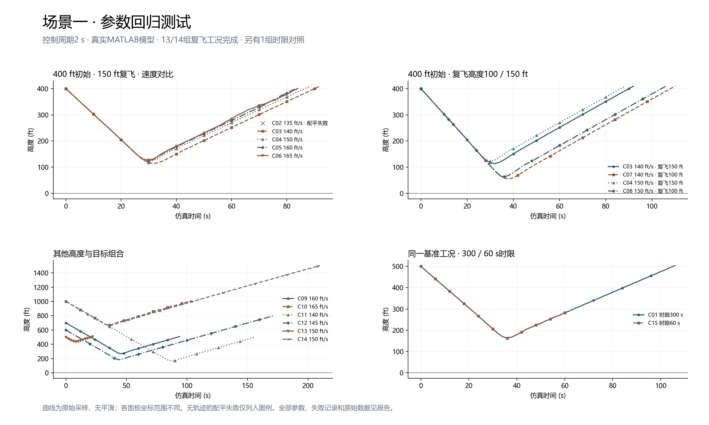

# 场景一验证快照（2026-11-11）

当前2秒控制周期下完成15组真实MATLAB测试：14组复飞组合中13组成功，135 ft/s测试点配平失败；另1组60秒时限对照按预期终止。

## 前端联调

- [frontend_presets.json](frontend_presets.json)：12组模型验证通过且不超过90步的参考参数；完整Dify验证另有标记。
- [matrix.json](matrix.json)：全部15组输入和预期事件，包括失败与时限对照。
- [summary.json](summary.json)、[summary.csv](summary.csv)：每组终止事件、最低高度、最大滚转、运行时间和步数。
- [pipeline_verification.json](pipeline_verification.json)：400 ft / 140 ft/s和700 ft / 160 ft/s两组完整Dify流程均通过全部评估。

使用参考项中的`parameters`调用`POST /api/simulations/prepare`，再使用本机返回的`preparation_id`调用`POST /api/runs`。快照中的运行ID用于追溯，不可替代新部署的配平记录。

135 ft/s测试点无法获得当前固定下降要求下的配平解。1500 ft目标组合在模型端完成，但需要105步，可能超出当前Dify单轮迭代预算；这两组不作为默认演示参数。有限测试点不代表全部连续参数组合均已验证。

## 复验

在项目根目录、配置好共享MATLAB的simulink环境中执行；真实仿真须独占MATLAB会话：

```powershell
$env:PYTHONPATH="$PWD\src"
python scripts/batch_engine_failure_regression.py --output data/runs/scene1-regression-recheck
```

可通过`--only C03 C09`选取工况。统计绘图需安装`requirements-analysis.txt`，再运行：

```powershell
python scripts/report_engine_failure_regression.py --input data/runs/scene1-regression-recheck
```

本快照保存输入、结果摘要和图表。原始状态、动作及MAT文件保存在测试机器的`data/runs/scene1-regression-20261111/`，不随源码提交。配平失败的堆栈在摘要中缩减为求解器原始失败原因，未改变失败分类。


